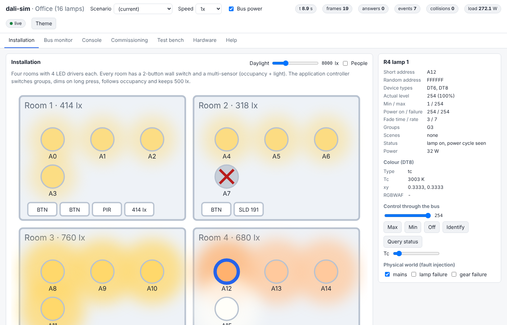
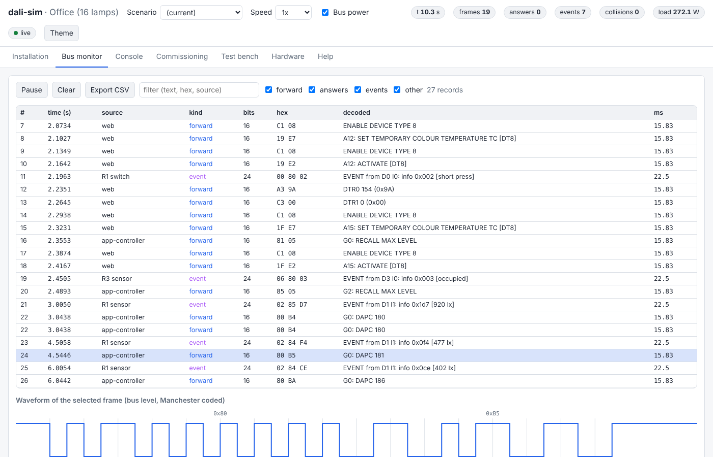
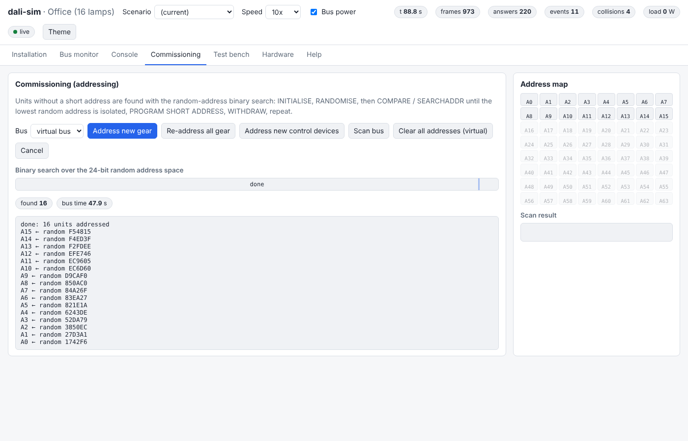
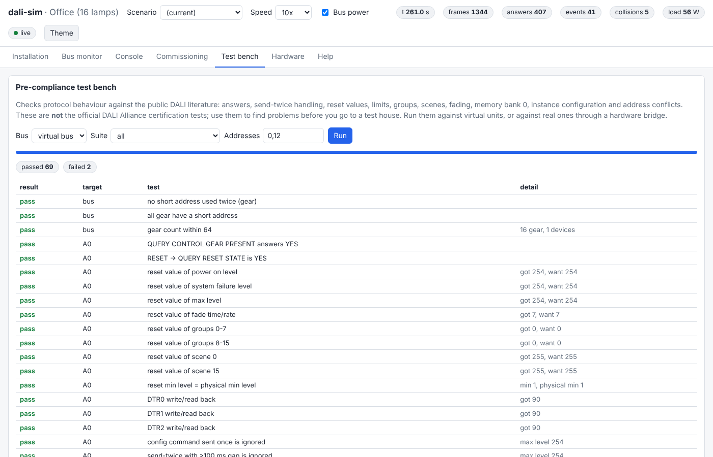

# dali-sim

**An open-source DALI / DALI-2 (IEC 62386) bus simulator.**
It has virtual control gear and control devices, bridges to real USB and Raspberry Pi DALI interfaces, a live web visualisation, a JSON API for any language, and Docker images.



Use it to:

- **Develop and test DALI controllers without hardware.** Up to 64 control gear and 64 control devices on one bus, with timing, collisions and fault injection.
- **Test real devices.** Drive real lamps and sensors through a USB interface. Run the pre-compliance test bench before you book a certification test.
- **Test real controllers.** Let a real controller talk to virtual devices, or mix real and virtual devices on one logical bus.
- **Learn DALI.** Watch every frame in the bus monitor with its decoding and Manchester waveform. See addressing happen step by step.
- **Run in CI and containers.** Headless mode, a TCP API, JUnit output and a Docker image.

> DALI, DALI-2 and D4i are trademarks of the DALI Alliance. This project is not affiliated with, endorsed by or certified by the DALI Alliance. It contains no text from IEC 62386; see [docs/sources.md](docs/sources.md) for where the behaviour comes from.

| Bus monitor with Manchester waveform | Commissioning (binary search) | Pre-compliance test bench |
|---|---|---|
|  |  |  |

## How to connect

**[docs/connections.md](docs/connections.md)** shows every way a DALI master can talk to the simulator (one machine, network, real DA+/DA− wires, Raspberry Pi wiring, Docker) with diagrams, and marks what is done, what is not yet tested, and where help is wanted.


## What is simulated

| Area | Coverage |
|---|---|
| Physical layer | 1200 bit/s Manchester coding and frame timing (16, 24 and 8-bit frames). Settling times by priority. Wired-AND superposition of answers, so different answers give framing errors. Multi-master arbitration and collisions with back-off. Bus power failure. Fault injection (lost or garbled frames). |
| Control gear, part 102 | All standard and special commands, including the DALI-2 additions. Variables and reset values, send-twice rule, fade time, fade rate and extended fade time, logarithmic dimming curve. Groups, scenes, limits and limit error, power-on and system-failure levels. Memory banks 0 and 1 with lock byte. Random addressing, identify. |
| Device types | **DT6** LED modules (part 207): linear/log curve, failure status, features. **DT8** colour (part 209): Tc, xy and RGBWAF, temporary values, ACTIVATE, colour fades, scenes with colour, QUERY COLOUR VALUE. **DT1** emergency (part 202): battery, function and duration tests, rest/inhibit, emergency level. |
| Control devices, part 103 | 24-bit commands, instances, event schemes, filters and priorities, groups, quiescent mode, application controller, memory banks, random addressing. |
| Input devices | Push buttons (301): short, double and long press, repeat, stuck. Absolute input (302): sliders and switches. Occupancy (303): hold, report and dead timers. Light sensors (304): hysteresis, dead time, report timer. |
| Application controller | A YAML rule engine that reacts to events (toggle, dim, scenes, occupancy) plus a daylight-harvesting control loop. |
| World model | Rooms, daylight and people. Light sensors measure daylight plus lamp light, so daylight control is a closed loop. |
| Tools | Commissioning (binary search), bus scan, pre-compliance test bench, command console, bus monitor with CSV export. |

The limits are listed in [docs/limitations.md](docs/limitations.md).

## Quick start

```bash
pip install "dali-sim[hardware] @ git+https://github.com/CodeSmithBob/dali-sim"
dali-sim serve office-16          # then open http://localhost:8080
```

Or from a checkout:

```bash
git clone https://github.com/CodeSmithBob/dali-sim && cd dali-sim
pip install -e ".[dev,hardware]"
dali-sim serve examples/building-64.yaml
```

Or with Docker:

```bash
docker build -t dali-sim .
docker run --rm -p 8080:8080 -p 5555:5555 dali-sim
# another scenario:
docker run --rm -p 8080:8080 dali-sim serve floor-32 --host 0.0.0.0
```

### Example scenarios (`examples/`)

| File | What it shows |
|---|---|
| `office-16.yaml` | 16 LED drivers in 4 rooms, wall switches, occupancy and light sensors, rules, daylight control |
| `floor-32.yaml` | 32 gear (LED, tunable white, RGBW, emergency) and 8 presence sensors with people walking around |
| `building-64.yaml` | A full bus: 64 gear and 16 control devices |
| `commissioning-64.yaml` | 64 gear and 16 devices straight from the factory (no addresses) to practise addressing |
| `colour-lab.yaml` | DT8: tunable white, RGBW, RGBWAF and xy gear |
| `emergency.yaml` | DT1 emergency luminaires running at 10x speed |

## Command line

```bash
dali-sim serve [CONFIG] [--adapter SPEC --bridge-mode controller|devices|hybrid]
dali-sim commission commissioning-64        # address a virtual bus (fast, simulated time)
dali-sim test office-16 --suite all --junit report.xml
dali-sim scan --adapter hasseb              # list the units on a real bus
dali-sim send --adapter hasseb FF05         # broadcast RECALL MAX LEVEL
dali-sim send --config office-16 A305 012E --twice   # DTR0=5, SET FADE TIME (twice)
dali-sim sniff --adapter serial:/dev/ttyUSB0
dali-sim decode FF90 A5FF C10100
dali-sim commands                           # all command tables as markdown
dali-sim adapters                           # supported interfaces and their capabilities
```

## Using it from your own software

- **TCP API (JSON lines, port 5555)** works from any language and any container. See [docs/api.md](docs/api.md).

  ```bash
  printf '{"op":"send","frames":["FF91"]}\n' | nc localhost 5555
  ```
- **REST and WebSocket** under `/api` and `/ws` drive the web UI. See [docs/api.md](docs/api.md).
- **Python**: import `dali_sim` and build a bus in a few lines. See [docs/python.md](docs/python.md).
- **Fake USB stick**: on Linux, `dali-sim serve --usb-stick tridonic` (or `lunatone`, `hasseb`) makes the simulator appear as that USB DALI stick, so existing DALI master software talks to the virtual bus without any wires. See [docs/hardware.md](docs/hardware.md#fake-usb-stick-no-wires).
- **Interface emulation**: point software written for an AtxLED HAT, a Lunatone LUBA interface, a daliserver or the dali-sim serial protocol at the simulator (`--pty`, `--pty-protocol`, `--daliserver-port`). See [docs/hardware.md](docs/hardware.md).

## Real hardware

| Interface | Spec | Status |
|---|---|---|
| hasseb DALI Master (USB HID) | `hasseb[:/dev/hidrawN]` | protocol from public drivers, needs hardware testing |
| Tridonic DALI USB (USB HID 17B5:0020) | `tridonic[:/dev/hidrawN]` | protocol from public drivers, needs hardware testing |
| Lunatone DALI USB (older HID model, same protocol as Tridonic) | `lunatone:/dev/hidrawN` | protocol from public drivers, needs hardware testing |
| Lunatone LUBA interfaces (RS232, USB virtual COM port) | `lunatone:/dev/ttyACM0` | protocol from public sources, needs hardware testing |
| AtxLED DALI HAT (Raspberry Pi) | `atxled:/dev/serial0` | from public drivers; python-dali's driver works against the emulated HAT |
| Any DIY interface speaking the [dali-sim serial protocol](docs/serial-protocol.md) | `serial:/dev/ttyUSB0` | specified here; firmware contributions welcome |
| Raspberry Pi GPIO + a DALI PHY | `gpio:tx=17,rx=27` | experimental, uses pigpio |
| daliserver (TCP) | `daliserver:host` | python-dali's client works against dali-sim's daliserver server |
| Another dali-sim (container, other machine) | `remote:host:5555` | tested |

All drivers are tested against byte-level emulators of the interfaces (`dali_sim/emulators.py`). The simulator can also **pretend to be** a serial interface (dali-sim protocol, AtxLED HAT or Lunatone LUBA on a virtual serial port) or a daliserver, so existing software can be tested against it. See [docs/hardware.md](docs/hardware.md).

Bridge modes:

- `controller`: the simulator drives the real bus. Use it for commissioning, scans, the test bench and the console.
- `devices`: a real controller drives the virtual devices. For the virtual devices to *answer* queries, the interface must be able to send backward frames within 5.5 to 10.5 ms. See [docs/hardware.md](docs/hardware.md).
- `hybrid`: virtual and real devices act as one bus.

**Please report results with your hardware** using the "Hardware report" issue template. That is the fastest way to move an adapter from "needs testing" to "tested".

## Certification (DALI-2, D4i)

Official certification is done by the DALI Alliance with its own test sequences at approved test houses. A simulator cannot certify a product. What dali-sim gives you:

- a **pre-compliance test bench** (`dali-sim test`, or the Test bench tab) for the behaviour that most often fails: send-twice handling, reset values, limits, groups, scenes, fades, memory bank 0, instance configuration and address conflicts;
- virtual installations of 16, 32 or 64 units for system tests of your controller;
- a way to check a real device against the same tests through a USB interface.

See [docs/certification.md](docs/certification.md).

## Documentation

- [Architecture](docs/architecture.md)
- [DALI in short](docs/protocol.md): frames, addressing, commands, commissioning, events
- [Configuration (YAML)](docs/configuration.md)
- [APIs: TCP, REST, WebSocket](docs/api.md) · [Python](docs/python.md)
- [Hardware and bridges](docs/hardware.md) · [Serial line protocol](docs/serial-protocol.md)
- [Docker](docs/docker.md)
- [Pre-compliance and certification](docs/certification.md)
- [Limitations](docs/limitations.md) · [Sources](docs/sources.md)

## Contributing

Contributions are very welcome: device types, adapters, firmware, tests, docs and UI. Start with the [help wanted issues](https://github.com/CodeSmithBob/dali-sim/issues?q=is%3Aissue+is%3Aopen+label%3A%22help+wanted%22) or the list at the end of [docs/connections.md](docs/connections.md#help-wanted). Read [CONTRIBUTING.md](CONTRIBUTING.md). Rule number one: **never paste text from the IEC 62386 standard.** Describe behaviour in your own words and cite the part and clause.

## License

[Apache License 2.0](LICENSE).
