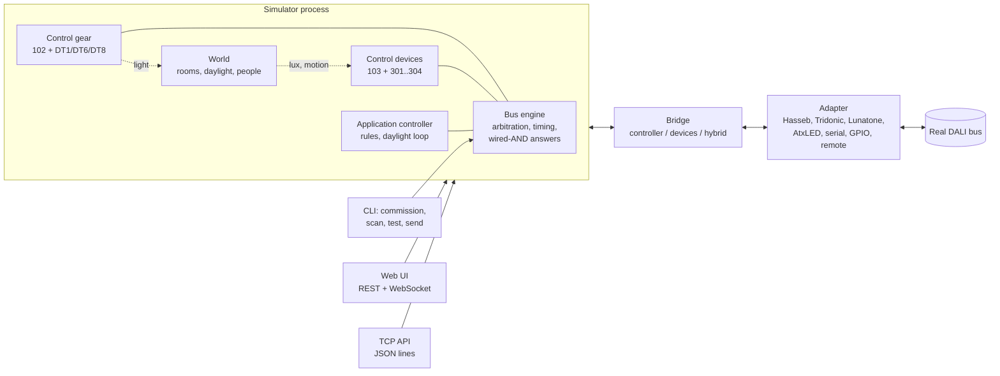

# Architecture



## Layers

| Layer | Module | Responsibility |
|---|---|---|
| Protocol | `dali_sim.protocol` | Pure functions and tables: frames, Manchester coding, timing constants, address and instance bytes, command tables, event encoding, dimming curves, the monitor's decoder. No state, no I/O. |
| Bus | `dali_sim.bus` | Queues transactions, picks the next one by priority (settling time), simulates collisions between multi-master transmitters, delivers each forward frame to every participant, and superimposes the answers. Keeps the monitor history. |
| Units | `dali_sim.gear`, `dali_sim.devices` | State machines of control gear and control devices. Each unit sees every frame (`on_frame`) and may return an answer. Timers (fades, identify, push-button timing, hold timers) run on the bus scheduler. |
| Controllers | `dali_sim.controller`, `dali_sim.automation` | `Controller` is the high-level API (commands, queries, scan, commissioning) over any *transport*. `AutomationController` is a control device that reacts to events with rules. |
| World | `dali_sim.world` | Rooms with daylight factors and lamp contributions; feeds light sensors and occupancy sensors. |
| Bridges and adapters | `dali_sim.bridge`, `dali_sim.adapters` | Connect a simulated bus with a real one. |
| Servers | `dali_sim.server` | Web UI, REST, WebSocket, TCP API. |

## Time

The simulator runs on **simulation time** (`dali_sim.clock`).

- `ManualClock` moves only when the bus works or when `bus.advance()` is called. Tests and the CLI use it. Commissioning 64 units takes about 150 s of bus time but under a second of wall time, and the results are deterministic for a fixed seed.
- `RealtimeClock` follows the wall clock, optionally sped up (the speed selector in the UI). `Bus.run()` paces transmissions so frames take their real duration.

A unit never reads the wall clock. It receives the time of each frame, and it computes values like the light level during a fade from the time it is asked about. That makes speeding up or slowing down safe.

## Transports

Everything that sends frames uses the same small interface:

```python
async def send(frames: Frame | list[Frame], *, source=..., priority=..., expect_answer=None) -> Reply
```

`Bus`, every `Adapter`, and `Bridge` implement it. The commissioning code, the test bench and the console therefore run unchanged against a virtual bus, a USB interface, or a remote simulator.

## Adding a device type

1. Add the command table in `protocol/commands.py` (opcodes, names, answer/twice flags).
2. Subclass `GearExtension` in `gear/` and implement `command()`, plus hooks such as `on_arc_power` and `state` if you need them.
3. Register a `type:` name in `config.py` (`make_gear`).
4. Add tests in `tests/` and a row in the README table.

Adding an input instance type works the same way, with `devices/instances.py` and `make_instance`.
