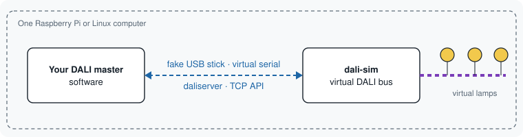
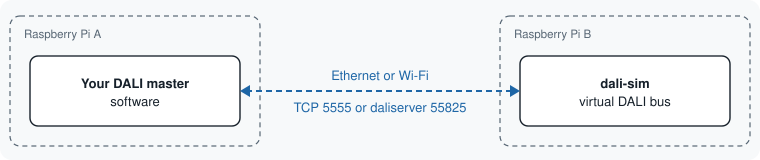
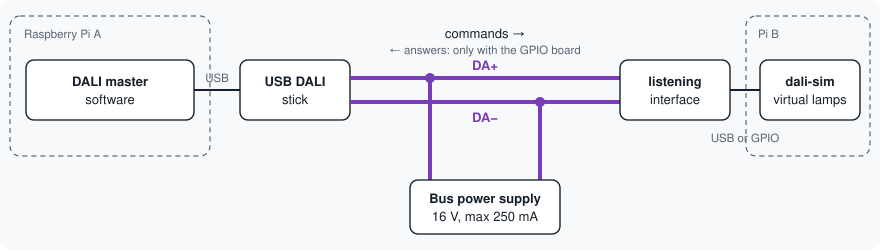
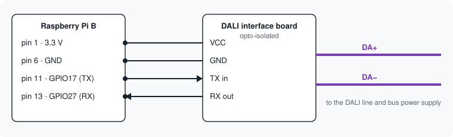
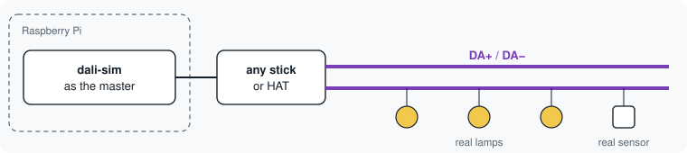
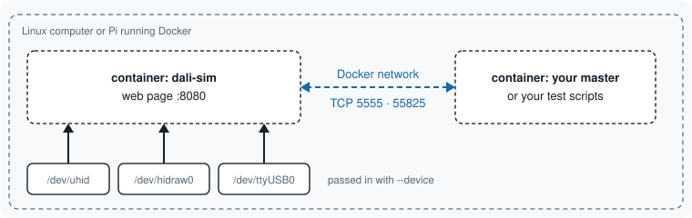

# How to connect a DALI master to dali-sim

Every way a DALI master (a program that sends DALI commands) can talk to the simulator, with a picture and the state of each part. Commands and details are in [hardware.md](hardware.md) and [docker.md](docker.md).

**Status marks used on this page**

| Mark | Meaning |
|---|---|
| ✅ | Works, covered by automated tests |
| 🟡 | Works in tests, **not yet tried** on real hardware or with commercial master software |
| 🧪 | Experimental |
| 🛠 | **Not built yet**: help wanted |
| ❌ | Not possible (a limit of the hardware) |

Every 🟡, 🧪 and 🛠 is a place where you can help. See [Help wanted](#help-wanted) at the end.

**In the pictures:** thick purple lines are DALI wires (DA+ and DA−), blue dashed lines are network or software links.

---

## 1. Master and simulator on one machine (recommended)



No wires and no extra hardware. The master believes it is talking to a real stick or interface.

| Your master expects | Start the simulator with | Status |
|---|---|---|
| a Tridonic, Lunatone (older) or hasseb USB stick | `sudo modprobe uhid` then `sudo dali-sim serve office-16 --usb-stick tridonic` (or `lunatone`, `hasseb`) | 🟡 tested with dali-sim's own drivers through an emulated kernel; not yet on a real Linux `/dev/uhid` or with commercial master software |
| an AtxLED HAT | `dali-sim serve office-16 --pty /tmp/dali --pty-protocol atxled`, then point the master at `/tmp/dali` | ✅ python-dali's AtxLED driver works against it |
| a Lunatone LUBA interface | `... --pty /tmp/dali --pty-protocol luba` | 🟡 |
| daliserver | `... --daliserver-port 55825` | ✅ python-dali's daliserver driver works against it |
| your own code | JSON over TCP, port 5555 ([api.md](api.md)) | ✅ |
| a USB stick, on Windows or macOS | | 🛠 fake USB sticks exist for Linux only |

## 2. Two machines over the network



| Your master speaks | How | Status |
|---|---|---|
| daliserver or TCP | `dali-sim serve office-16 --host 0.0.0.0 --daliserver-port 55825` on Pi B | ✅ |
| a serial interface | tunnel the virtual serial port with `socat` ([hardware.md](hardware.md)) | 🟡 not tried yet |
| a USB stick | the fake stick has to be on the master's machine (setup 1) | 🛠 a "remote fake stick" (stick on Pi A, simulator on Pi B) is not built |

## 3. Two machines over real DALI wires



The simulator machine needs its own DALI interface on the same wires, and it must be able to **listen**. Every command then reaches the virtual lamps. To **answer** the master's questions ("who is there?", "what is your level?"), the interface must send a reply within 5.5 to 10.5 ms, which most USB sticks cannot do on request. Without answers, a master cannot find lamps during setup; switching and dimming still work.

The DALI line also needs a **bus power supply** (about 16 V, at most 250 mA) unless one of the interfaces has one built in.

| Interface on the simulator machine | Lamps obey commands | Answers questions | Status |
|---|---|---|---|
| Raspberry Pi GPIO + DALI interface board | yes | yes, if the Pi reacts in time | 🧪 tested against a software stand-in for the GPIO chip only |
| Tridonic DALI USB | yes | no ❌ | 🟡 |
| Lunatone DALI USB (older model) | yes | no ❌ | 🟡 |
| Lunatone LUBA (serial) | yes | no ❌ | 🟡 |
| hasseb DALI Master | no ❌ (cannot listen) | no ❌ | not usable here |
| AtxLED HAT | no ❌ (cannot listen) | no ❌ | not usable here |
| Microcontroller (RP2040, ESP32...) with the [dali-sim serial protocol](serial-protocol.md) | yes | yes | 🛠 the protocol is specified, the firmware is not written |

```bash
dali-sim serve office-16 --adapter tridonic --bridge-mode devices           # USB stick
sudo pigpiod && dali-sim serve office-16 --adapter gpio:tx=17,rx=27 --bridge-mode devices   # GPIO board
```

### Raspberry Pi wiring for the GPIO option 🧪



| Pi pin | Signal | Board |
|---|---|---|
| 1 | 3.3 V | VCC |
| 6 | GND | GND |
| 11 | GPIO17, transmit | TX in |
| 13 | GPIO27, receive | RX out |

> **Never connect DA+ or DA− straight to the Pi's pins.** The DALI line carries up to 22.5 V and will destroy the Pi. Always use an interface board with an opto-isolated receiver and a transistor driver.

Boards differ: if the signals are inverted, add `tx_invert=1` or `rx_invert=0` to the adapter spec. 🛠 We do not yet have a list of boards known to work, or a tested open-hardware schematic. Please share yours.

## 4. The simulator drives real lamps



The other direction. The simulator's web page, console, addressing tool and pre-compliance test bench control real lamps and sensors.

| Interface | Status |
|---|---|
| Tridonic DALI USB, Lunatone DALI USB (older), Lunatone LUBA, hasseb DALI Master, AtxLED HAT | 🟡 byte formats from public open-source drivers, tested against emulated interfaces, not yet on real hardware |
| Raspberry Pi GPIO + DALI board | 🧪 |
| daliserver, another dali-sim | ✅ |

```bash
dali-sim serve office-16 --adapter tridonic --bridge-mode controller
```

**Mixed bus:** `--bridge-mode hybrid` makes real and virtual lamps act as one bus. 🟡 tested with two simulated buses only.

## 5. Docker



| What you want | How | Status |
|---|---|---|
| Master in another container | `docker compose up`; connect to `dali-sim:5555` or `dali-sim:55825` | ✅ CI runs a second container against the simulator |
| Master on the host, fake USB stick | `docker run --user root --device /dev/uhid ... --usb-stick tridonic` | 🟡 not tried in Docker yet |
| Real USB stick or serial interface | `--device /dev/hidraw0` or `--device /dev/ttyUSB0`, plus `--adapter ...` | 🟡 |
| Raspberry Pi GPIO board | `pigpiod` on the Pi, then `--network host ... --adapter gpio:tx=17,rx=27,host=127.0.0.1` | 🧪 |
| Docker Desktop on Windows or macOS | network only: TCP 5555 and daliserver | ✅ network / ❌ USB, fake sticks and GPIO |
| Ready-made image on a registry (`docker pull`) | | 🛠 the image is only built locally today; a published multi-arch image (amd64 + arm64 for the Pi) is welcome |

## Masters with several DALI outputs

DALI allows 64 lights per line, so bigger installations use several lines, and many masters and gateways have 2, 4 or more DALI outputs. One simulator can run several lines (`lines:` in the configuration, see [configuration.md](configuration.md#several-dali-lines)). Each line gets its own connection, so each output of your master maps to one line:

```bash
sudo dali-sim serve three-lines --usb-stick tridonic,tridonic,tridonic   # one fake stick per line
dali-sim serve three-lines --host 0.0.0.0 --daliserver-port 55825      # TCP 5555-5557, daliserver 55825-55827
```

| What | Status |
|---|---|
| Several lines in one simulator, one web page, one container | ✅ |
| TCP, daliserver and virtual serial ports per line | ✅ |
| One fake USB stick per line, each with its own serial number | 🟡 like single fake sticks: not yet tried on a real `/dev/uhid` |
| Real DALI wires: one listening interface per line (`--adapter tridonic@2`) | 🟡 / 🧪 as in setup 3 |

## 6. Tridonic, Lunatone, hasseb, AtxLED: what they are

These companies make the small box between a computer and the DALI wires. A master program is written for one of them. The simulator works with each in two ways: it can **pretend to be** the box (no wires), or it can **use** a real box on real wires.

| | Tridonic DALI USB | Lunatone DALI USB (older) | Lunatone LUBA | hasseb DALI Master | AtxLED HAT |
|---|---|---|---|---|---|
| What it is | USB stick | USB stick, same protocol as Tridonic | Lunatone boxes with a serial link | USB stick | board on a Raspberry Pi |
| Simulator pretends to be it | 🟡 `--usb-stick tridonic` | 🟡 `--usb-stick lunatone` | 🟡 `--pty-protocol luba` | 🟡 `--usb-stick hasseb` | ✅ `--pty-protocol atxled` |
| Simulator uses it to control real lamps | 🟡 | 🟡 | 🟡 | 🟡 | 🟡 |
| Simulator uses it to listen to another master | 🟡 | 🟡 | 🟡 | ❌ | ❌ |
| Simulator answers another master through it | ❌ | ❌ | ❌ | ❌ | ❌ |

Not supported yet 🛠: newer Lunatone DALI-2 USB models (if they do not use LUBA), Tridonic DALI-2 USB, Helvar, Zennio, Foxtron and other interfaces. Protocol descriptions from public sources are welcome.

---

## Help wanted

Pick anything below and open an issue or a pull request. Read [CONTRIBUTING.md](../CONTRIBUTING.md) first: never paste text from the IEC 62386 standard.

All open tasks: [issues labelled "help wanted"](https://github.com/CodeSmithBob/dali-sim/issues?q=is%3Aissue+is%3Aopen+label%3A%22help+wanted%22). Easy starting points carry the label [good first issue](https://github.com/CodeSmithBob/dali-sim/issues?q=is%3Aissue+is%3Aopen+label%3A%22good+first+issue%22).

**Have hardware? Test it** (no programming needed):

- 🟡 Tridonic or older Lunatone DALI USB stick: [#1](https://github.com/CodeSmithBob/dali-sim/issues/1)
- 🟡 hasseb DALI Master: [#2](https://github.com/CodeSmithBob/dali-sim/issues/2)
- 🟡 AtxLED HAT on a Raspberry Pi: [#3](https://github.com/CodeSmithBob/dali-sim/issues/3)
- 🟡 Lunatone LUBA interfaces, and checking the protocol against Lunatone's document: [#4](https://github.com/CodeSmithBob/dali-sim/issues/4)
- 🟡 Fake USB stick on real Linux with DALI master software: [#5](https://github.com/CodeSmithBob/dali-sim/issues/5)
- 🧪 Raspberry Pi GPIO with a DALI interface board: [#6](https://github.com/CodeSmithBob/dali-sim/issues/6)
- 🟡 Docker with a real stick, the fake stick or GPIO: [#7](https://github.com/CodeSmithBob/dali-sim/issues/7)

**Can build things?**

- 🛠 Firmware for an RP2040 or ESP32 that speaks the [dali-sim serial protocol](serial-protocol.md), so virtual lamps can answer over real wires: [#8](https://github.com/CodeSmithBob/dali-sim/issues/8)
- 🛠 Open-hardware DALI interface board for the Raspberry Pi (KiCad): [#9](https://github.com/CodeSmithBob/dali-sim/issues/9)
- 🛠 Published Docker image for amd64 and arm64: [#10](https://github.com/CodeSmithBob/dali-sim/issues/10)
- 🛠 Fake USB sticks on Windows and macOS: [#11](https://github.com/CodeSmithBob/dali-sim/issues/11)
- 🛠 Remote fake stick (stick on one machine, simulator on another): [#12](https://github.com/CodeSmithBob/dali-sim/issues/12)
- 🛠 More interfaces: DALI-2 USB models, Helvar and others: [#13](https://github.com/CodeSmithBob/dali-sim/issues/13)

**Like reading documents?**

- Check the "To verify" protocol values against public sources: [#14](https://github.com/CodeSmithBob/dali-sim/issues/14)

When something moves from 🟡 to ✅, update the tables on this page in the same pull request.
